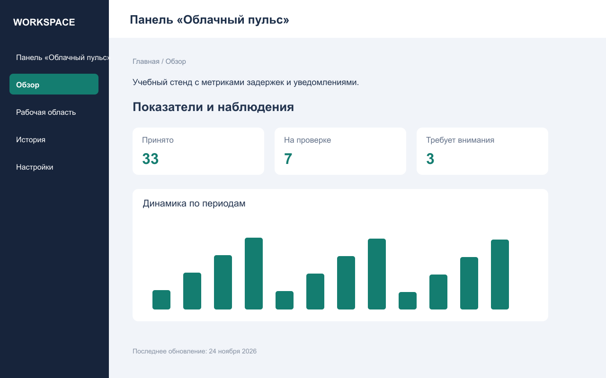
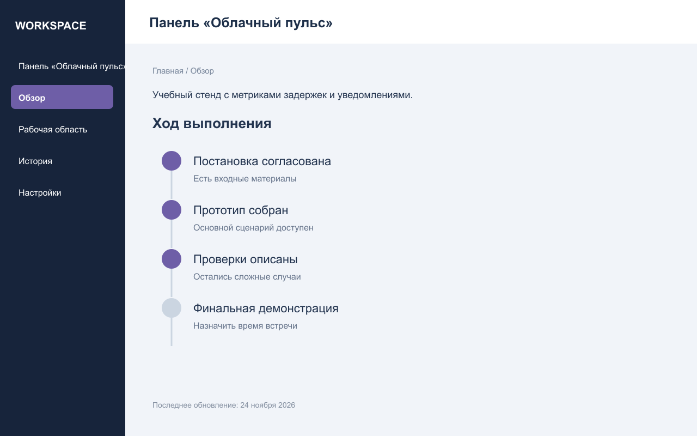

# Панель «Облачный пульс»

Даниил Лебедев / DevOps

## Задача

Ошибки обнаруживаются по обращениям пользователей, а не по метрикам.

## Решение

Учебный стенд с метриками задержек и уведомлениями.

## Основной сценарий

Проверены отказ зависимости и восстановление; в журналах нет секретов.

## Личный вклад

Модель данных и API, обработка ошибок и инструкция развёртывания.

## Следующий этап

Расширить контрольные сценарии и проверить поведение на неполном входе.

## Изображения интерфейса

[Портфолио PDF](../documents/portfolios/syn_project_013.pdf) / [Презентация PDF](../documents/presentations/syn_project_013.pdf)
