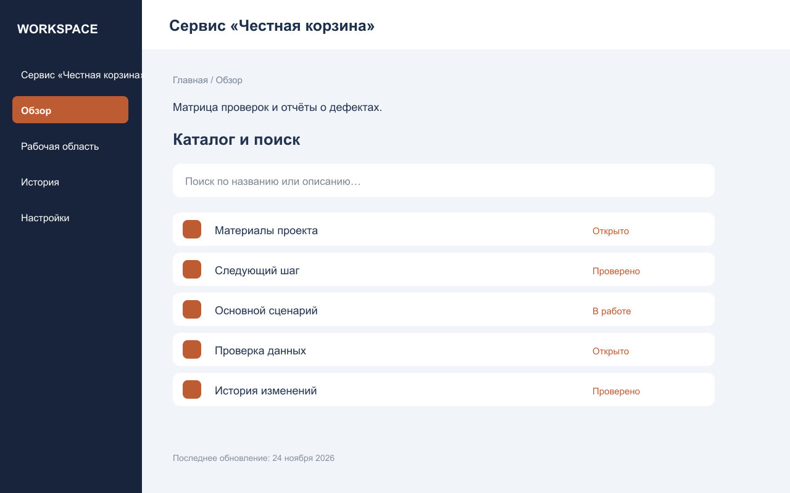
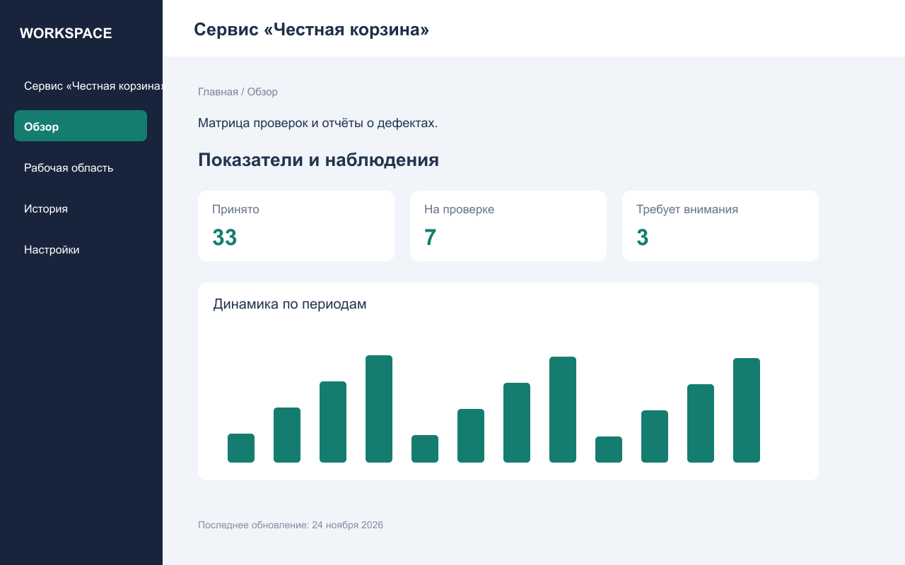

# Сервис «Честная корзина»

София Попова / Тестирование

## Задача

Комбинации скидок и количества приводят к неверной сумме.

## Решение

Матрица проверок и отчёты о дефектах.

## Основной сценарий

Есть округление, нулевой остаток и двойное нажатие; реальных платежей нет.

## Личный вклад

Пользовательские сценарии, макеты и интерфейс с состояниями загрузки.

## Следующий этап

Добавить обратную связь пользователей и уточнить основной сценарий.

## Изображения интерфейса

[Портфолио PDF](../documents/portfolios/syn_project_014.pdf) / [Презентация PDF](../documents/presentations/syn_project_014.pdf)
