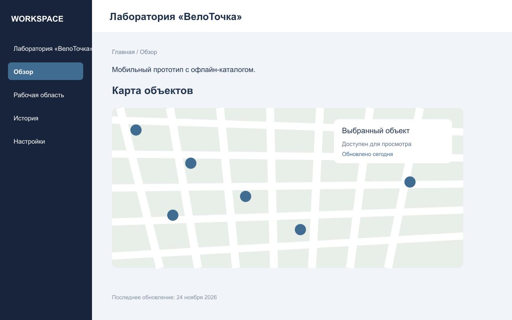
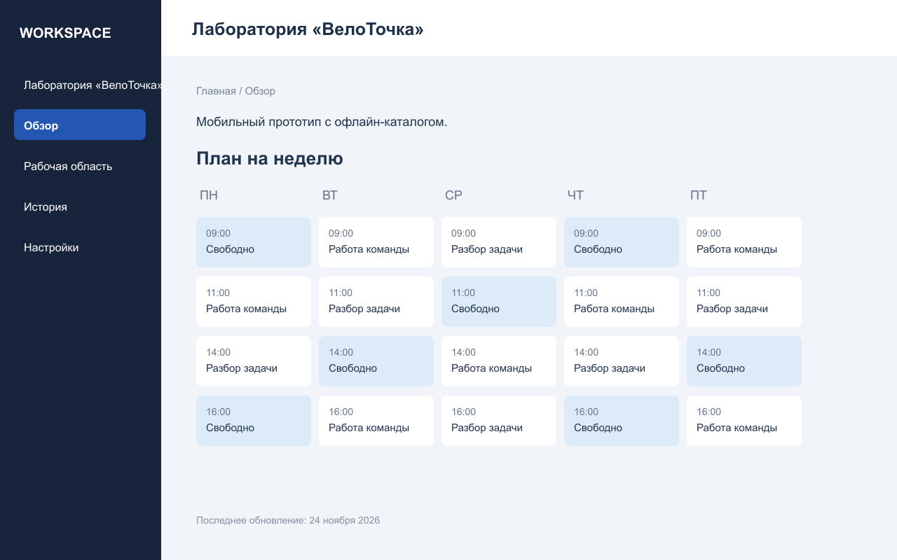

# Лаборатория «ВелоТочка»

Артём Павлов / Мобильная разработка

## Задача

При потере сети сохранённые места перестают отображаться.

## Решение

Мобильный прототип с офлайн-каталогом.

## Основной сценарий

Синхронизация не дублирует место; давность сведений видна.

## Личный вклад

Исследование входных данных, сравнение подходов и графики результатов.

## Следующий этап

Оптимизировать обработку больших наборов и измерить потребление памяти.

## Изображения интерфейса

[Портфолио PDF](../documents/portfolios/syn_project_015.pdf) / [Презентация PDF](../documents/presentations/syn_project_015.pdf)
