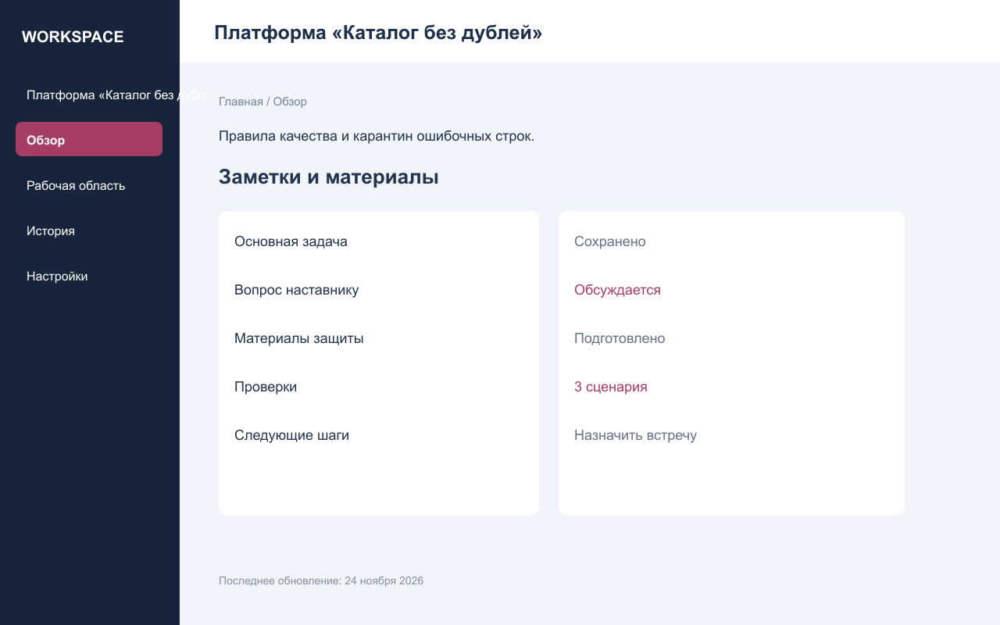
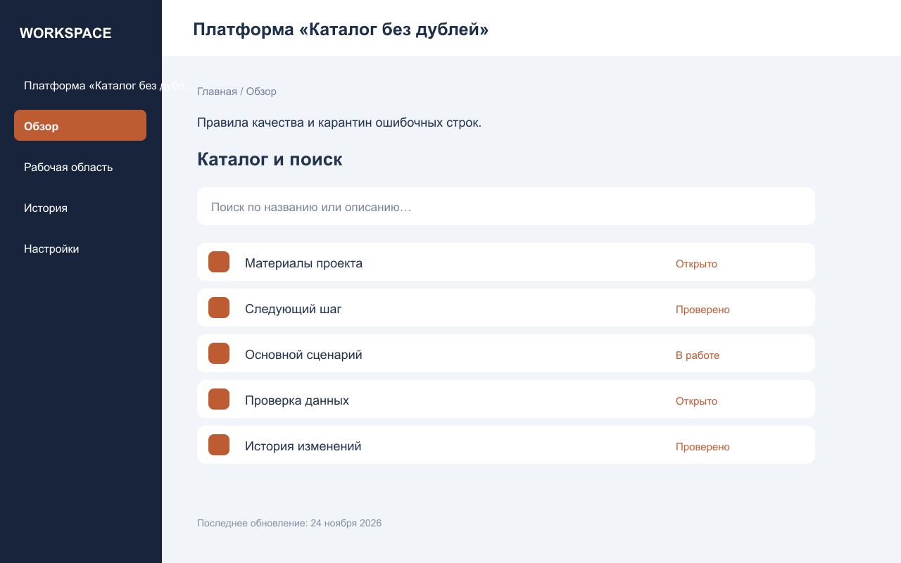

# Платформа «Каталог без дублей»

Виктория Кузнецова / Big Data

## Задача

Дубли артикулов и разные единицы массы искажают отчёт.

## Решение

Правила качества и карантин ошибочных строк.

## Основной сценарий

Исходная строка сохраняется; граммы и килограммы приводятся явно.

## Личный вклад

Матрица проверок, регрессионные сценарии и разбор ограничений.

## Следующий этап

Подготовить демонстрацию и документацию для передачи следующей команде.

## Изображения интерфейса

[Портфолио PDF](../documents/portfolios/syn_project_016.pdf) / [Презентация PDF](../documents/presentations/syn_project_016.pdf)
