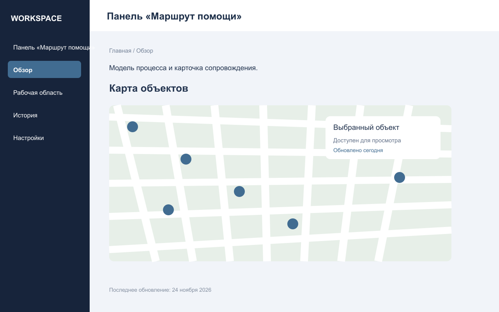
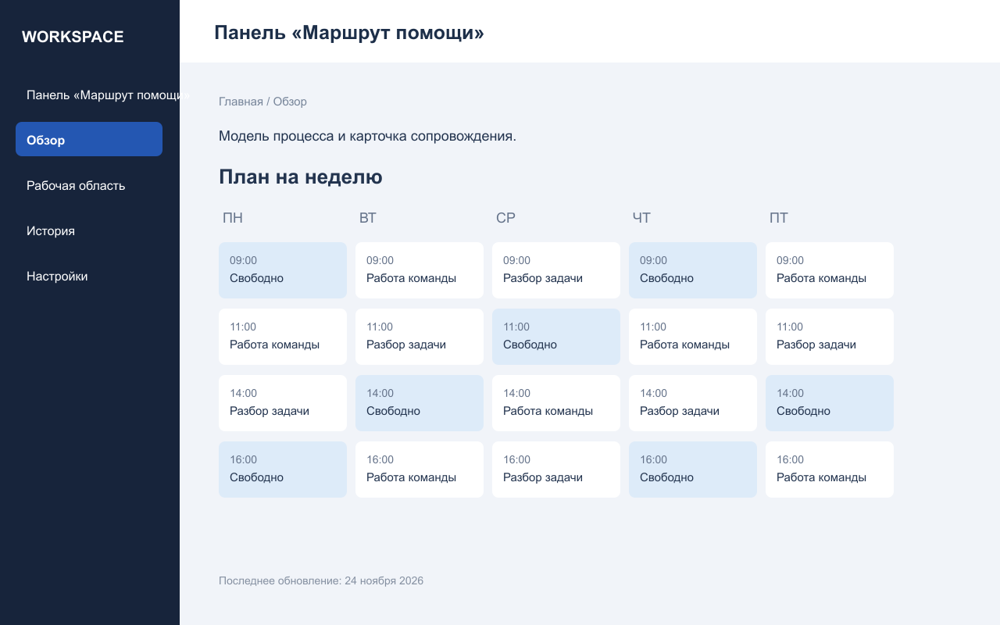

# Панель «Маршрут помощи»

Кирилл Семёнов / Системный анализ

## Задача

Договорённости теряются при передаче обращения между сменами.

## Решение

Модель процесса и карточка сопровождения.

## Основной сценарий

У переходов есть ответственные; причина возврата обязательна.

## Личный вклад

Модель данных и API, обработка ошибок и инструкция развёртывания.

## Следующий этап

Расширить контрольные сценарии и проверить поведение на неполном входе.

## Изображения интерфейса

[Портфолио PDF](../documents/portfolios/syn_project_017.pdf) / [Презентация PDF](../documents/presentations/syn_project_017.pdf)
