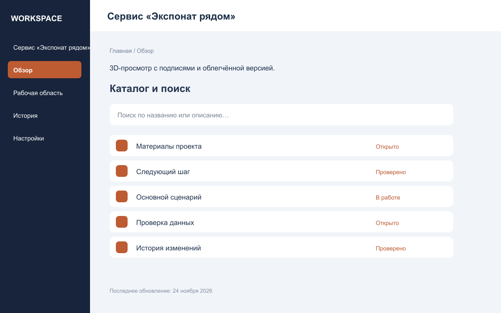
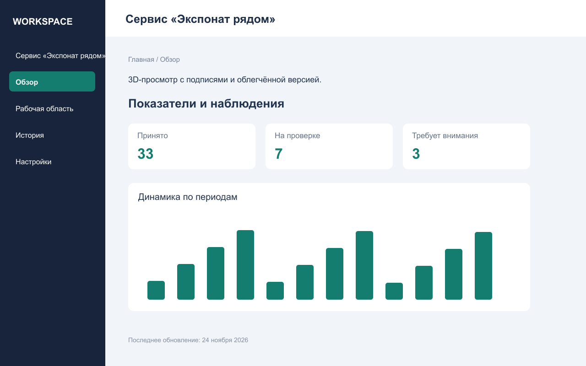

# Сервис «Экспонат рядом»

Елизавета Зайцева / AR/VR

## Задача

Небольшая деталь экспоната не видна за стеклом.

## Решение

3D-просмотр с подписями и облегчённой версией.

## Основной сценарий

Доступно управление без жестов; происхождение модели указано.

## Личный вклад

Пользовательские сценарии, макеты и интерфейс с состояниями загрузки.

## Следующий этап

Добавить обратную связь пользователей и уточнить основной сценарий.

## Изображения интерфейса

[Портфолио PDF](../documents/portfolios/syn_project_018.pdf) / [Презентация PDF](../documents/presentations/syn_project_018.pdf)
