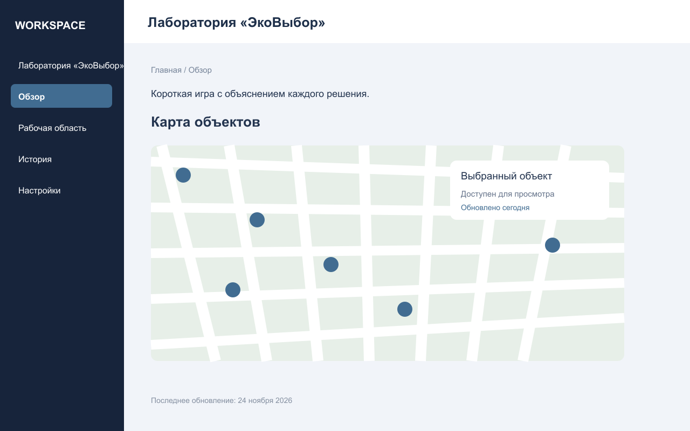
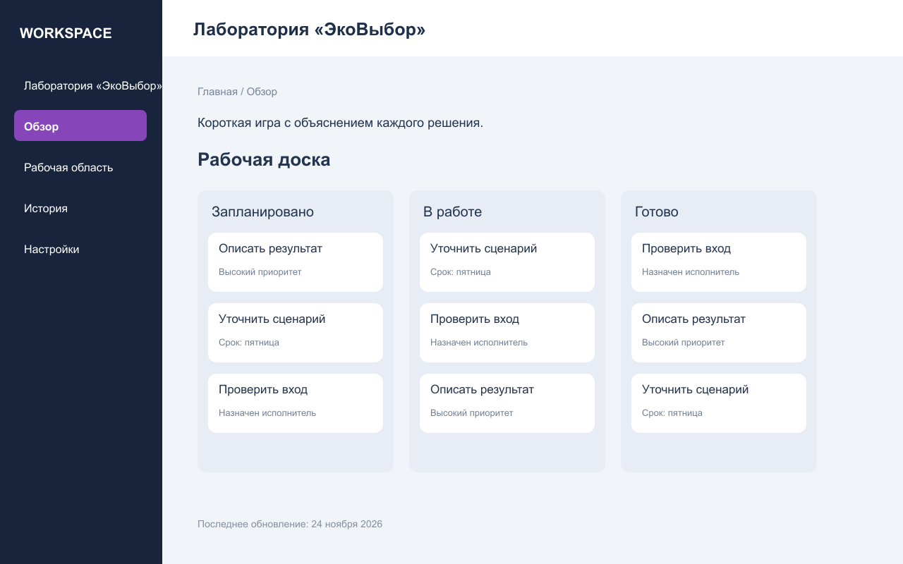

# Лаборатория «ЭкоВыбор»

Андрей Громов / Разработка игр

## Задача

Ученик помнит цвет контейнера, но не понимает неоднозначные предметы.

## Решение

Короткая игра с объяснением каждого решения.

## Основной сценарий

Правила относятся к условному городу; ошибку сопровождает объяснение.

## Личный вклад

Исследование входных данных, сравнение подходов и графики результатов.

## Следующий этап

Оптимизировать обработку больших наборов и измерить потребление памяти.

## Изображения интерфейса

[Портфолио PDF](../documents/portfolios/syn_project_019.pdf) / [Презентация PDF](../documents/presentations/syn_project_019.pdf)
