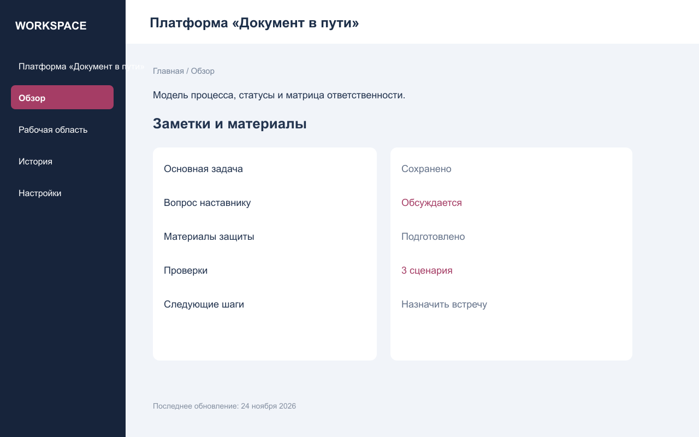
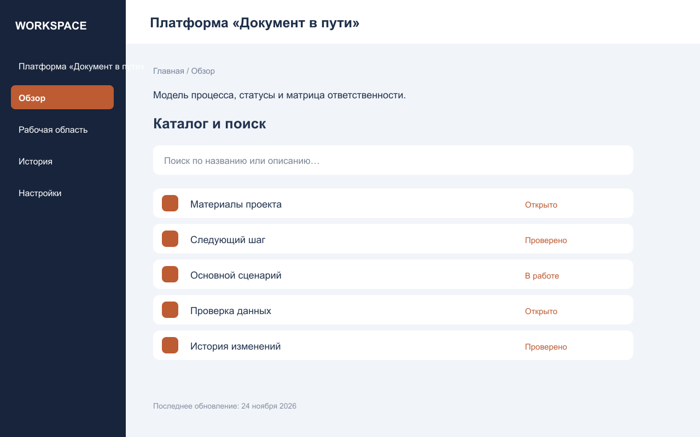

# Платформа «Документ в пути»

Ксения Фролова / Бизнес-анализ

## Задача

Неясно, на чьём шаге остановился документ.

## Решение

Модель процесса, статусы и матрица ответственности.

## Основной сценарий

Есть возврат и повторная подача; версии не стираются.

## Личный вклад

Матрица проверок, регрессионные сценарии и разбор ограничений.

## Следующий этап

Подготовить демонстрацию и документацию для передачи следующей команде.

## Изображения интерфейса

[Портфолио PDF](../documents/portfolios/syn_project_020.pdf) / [Презентация PDF](../documents/presentations/syn_project_020.pdf)
