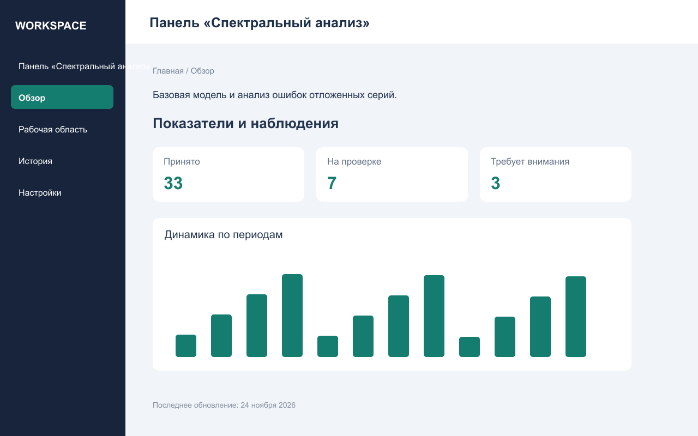
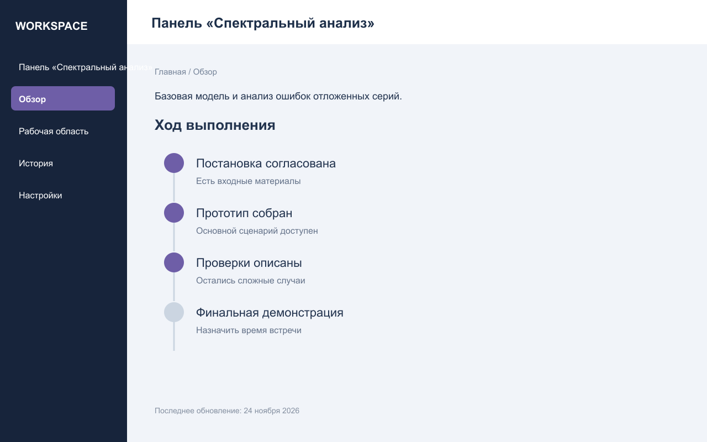

# Панель «Спектральный анализ»

Алексей Миронов Алексеевич / Машинное обучение

## Задача

Спектры имеют шум и разную длину серии.

## Решение

Базовая модель и анализ ошибок отложенных серий.

## Основной сценарий

Связанные измерения не попадают в обучение и тест одновременно.

## Личный вклад

Модель данных и API, обработка ошибок и инструкция развёртывания.

## Следующий этап

Расширить контрольные сценарии и проверить поведение на неполном входе.

## Изображения интерфейса

[Портфолио PDF](../documents/portfolios/syn_project_021.pdf) / [Презентация PDF](../documents/presentations/syn_project_021.pdf)
