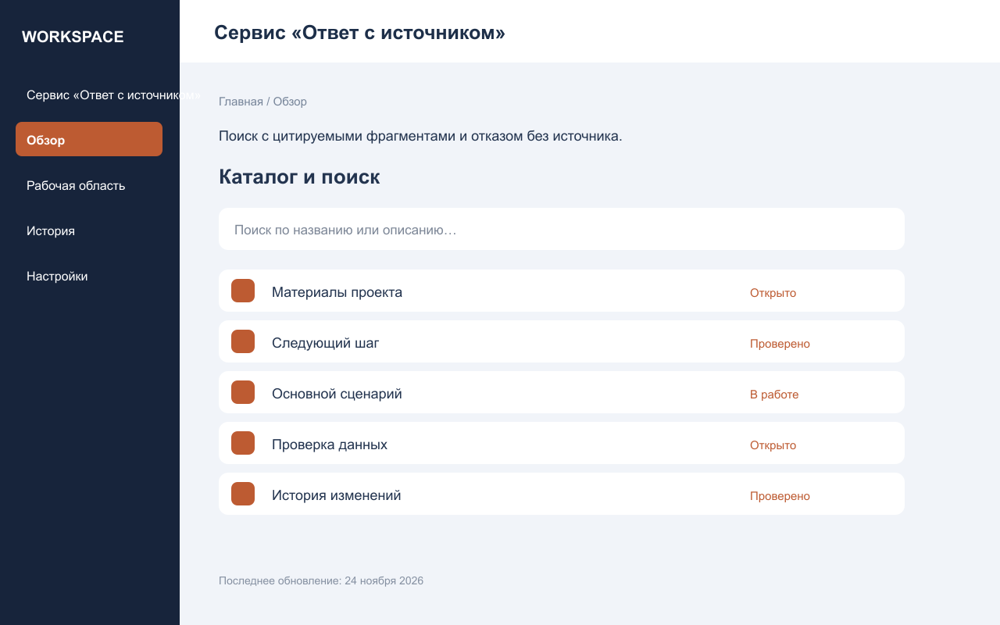
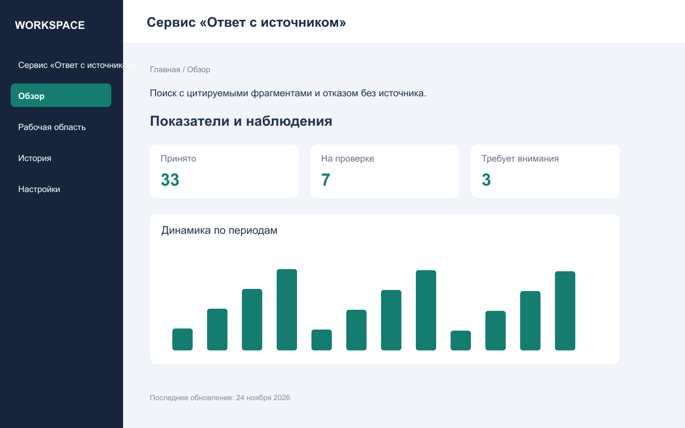

# Сервис «Ответ с источником»

Мария Белова Андреевна / Искусственный интеллект

## Задача

Ответы на организационные вопросы разбросаны по документам.

## Решение

Поиск с цитируемыми фрагментами и отказом без источника.

## Основной сценарий

Ответ связан с фрагментом; неподтверждённое не выдаётся за факт.

## Личный вклад

Пользовательские сценарии, макеты и интерфейс с состояниями загрузки.

## Следующий этап

Добавить обратную связь пользователей и уточнить основной сценарий.

## Изображения интерфейса

[Портфолио PDF](../documents/portfolios/syn_project_022.pdf) / [Презентация PDF](../documents/presentations/syn_project_022.pdf)
