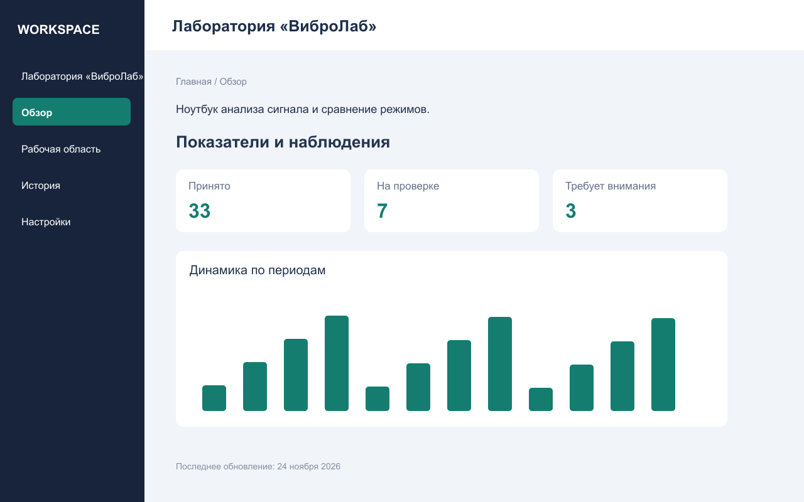
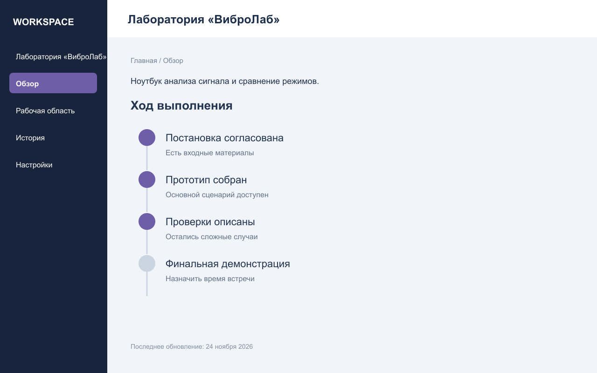

# Лаборатория «ВиброЛаб»

Тимур Сафин Алексеевич / Физика

## Задача

Пики спектра меняются при разной частоте дискретизации.

## Решение

Ноутбук анализа сигнала и сравнение режимов.

## Основной сценарий

Есть единицы и частота дискретизации; промышленная диагностика не заявляется.

## Личный вклад

Исследование входных данных, сравнение подходов и графики результатов.

## Следующий этап

Оптимизировать обработку больших наборов и измерить потребление памяти.

## Изображения интерфейса

[Портфолио PDF](../documents/portfolios/syn_project_023.pdf) / [Презентация PDF](../documents/presentations/syn_project_023.pdf)
