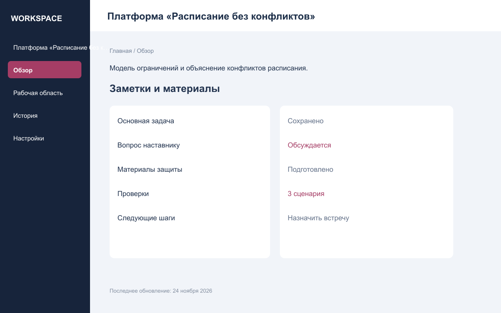
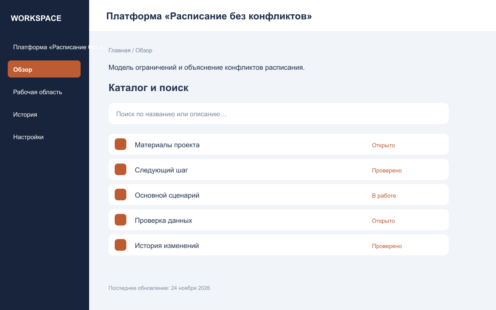

# Платформа «Расписание без конфликтов»

Анна Волкова Андреевна / Математика

## Задача

Группы делят ограниченное оборудование и преподавателей.

## Решение

Модель ограничений и объяснение конфликтов расписания.

## Основной сценарий

Невыполнимый набор возвращает причину; варианты сравниваются на одинаковом входе.

## Личный вклад

Матрица проверок, регрессионные сценарии и разбор ограничений.

## Следующий этап

Подготовить демонстрацию и документацию для передачи следующей команде.

## Изображения интерфейса

[Портфолио PDF](../documents/portfolios/syn_project_024.pdf) / [Презентация PDF](../documents/presentations/syn_project_024.pdf)
