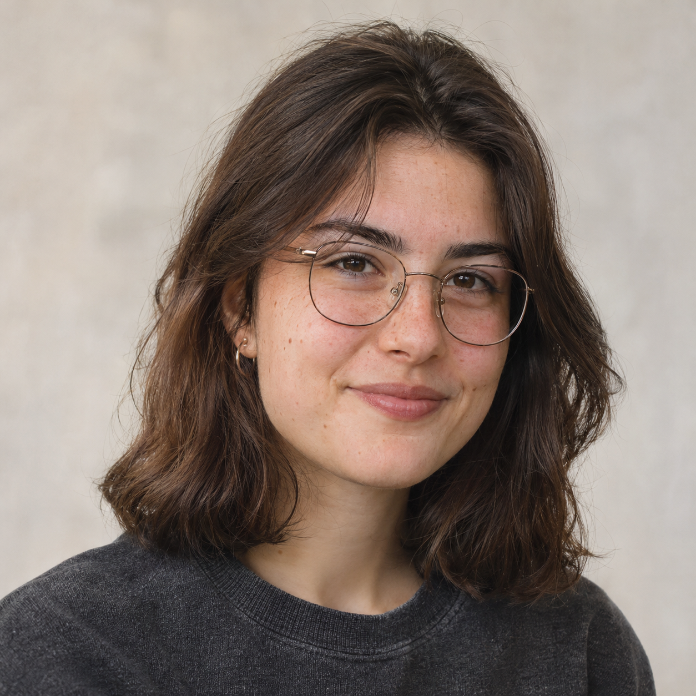

# Мария Белова Андреевна

Разработчик IoT / Junior

Развиваюсь как разработчик iot. Интересуют телеметрия и работа с потерей связи. Собрала панель измерений с разделением простоя и потери связи. В команде беру на себя приём сигналов, единицы измерения и журнал предупреждений. Ищу задачу с измеримым результатом. Доступно 12 часов в неделю.

## Навыки

Python, MQTT, C++, Grafana

[Резюме PDF](../documents/resumes/syn_student_022.pdf)
