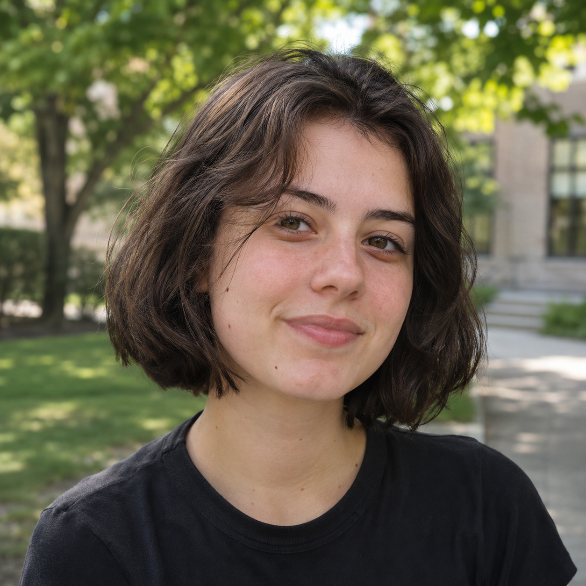

# Дарья Соколова Андреевна

Backend-разработчик / Junior

Развиваюсь как backend-разработчик. Интересуют надёжные API и очереди событий. Реализовала идемпотентный приём заявок и журнал повторов. В команде беру на себя контракты API, транзакции и обработка конфликтов. Ищу небольшой продуктовый проект. Доступно 8 часов в неделю.

## Навыки

Go, PostgreSQL, Docker, OpenAPI

[Резюме PDF](../documents/resumes/syn_student_026.pdf)
