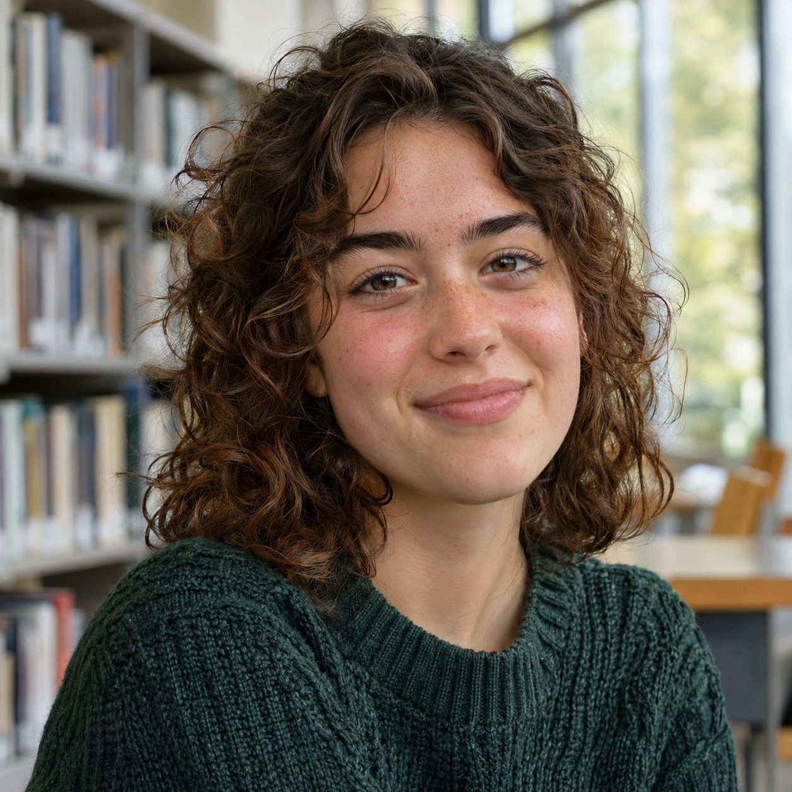

# Алина Иванова Андреевна

ML-инженер / Junior

Развиваюсь как ml-инженер. Интересуют базовые модели и проверка качества на отложенных данных. Сравнила классификатор обращений с базовым поиском по словам. В команде беру на себя подготовка выборки, оценка ошибок и сервис предсказаний. Ищу исследовательскую задачу. Доступно 16 часов в неделю.

## Навыки

Python, scikit-learn, NumPy, FastAPI

[Резюме PDF](../documents/resumes/syn_student_030.pdf)
