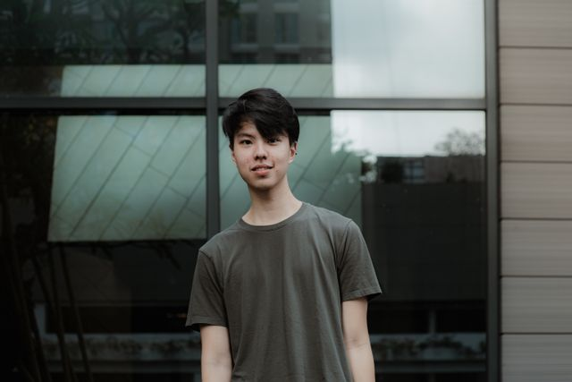

# Даниил Лебедев Сергеевич

QA-инженер / Стажёр с проектным опытом

Развиваюсь как qa-инженер. Интересуют граничные случаи и воспроизводимые проверки. Составил матрицу прав для четырёх ролей и негативные проверки API. В команде беру на себя тест-дизайн, автоматизация и отчёты о дефектах. Ищу стажировку с код-ревью. Доступно 14 часов в неделю.

## Навыки

Python, pytest, HTTP

[Резюме PDF](../documents/resumes/syn_student_053.pdf)
