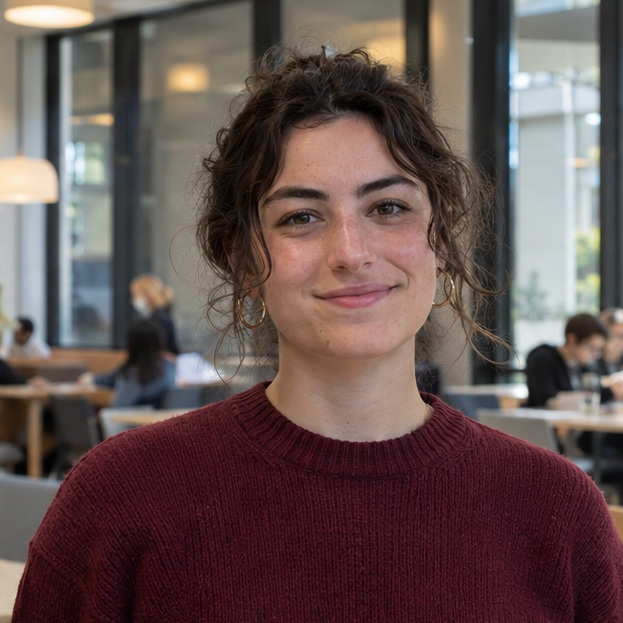

# Ксения Фролова Викторовна

Инженер компьютерного зрения / Стажёр с проектным опытом

Развиваюсь как инженер компьютерного зрения. Интересуют обработка изображений и разбор ошибок. Подготовила конвейер выравнивания сканов с ручной проверкой сложных кадров. В команде беру на себя обработка изображений, разметка и сравнение результатов. Ищу исследовательскую задачу. Доступно 16 часов в неделю.

## Навыки

Python, OpenCV, PyTorch, NumPy

[Резюме PDF](../documents/resumes/syn_student_060.pdf)
