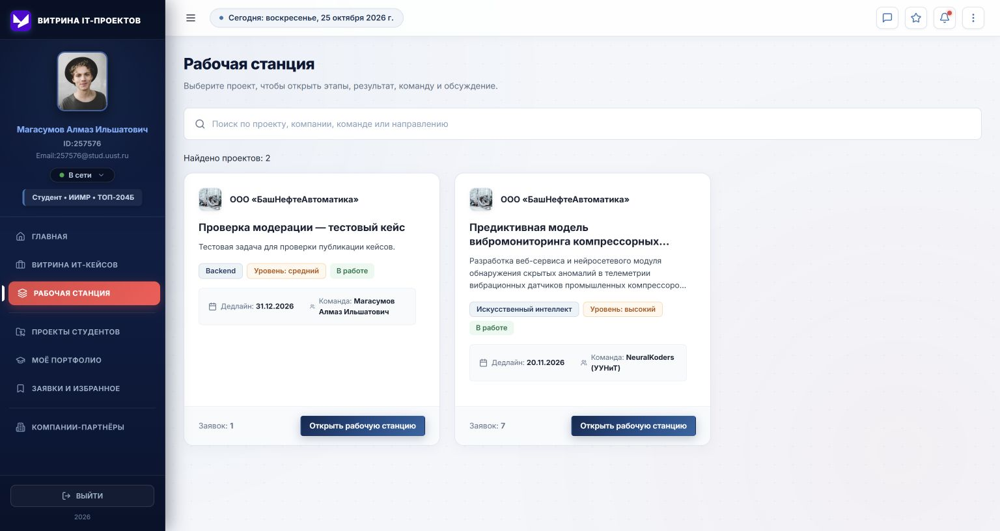

# Проверка фронтенда по ТЗ и замечаниям от 25.10.2026

Основание: предоставленное «Техническое задание: Витрина ИТ-проектов», 18 страниц; текущие исходники frontend; ручной прогон в Chrome в режиме mock; автоматические тесты. Документ фиксирует реализованное поведение и оставшиеся ограничения. Наличие кнопки или mock-ответа не означает готовую интеграцию с сервером.

## Что изменено в этом проходе

- Установлено предоставленное изображение логотипа в шапке бокового меню.
- Рабочая станция/мониторинг и избранное используют один компонент ProjectSummaryCard с одинаковой структурой, метаданными и оформлением. Поиск работает по проекту, компании, направлению, технологиям и команде. В избранном появились отдельные вкладки сохраненных кейсов и собственных заявок.
- Внутри рабочей станции есть «Назад» к списку проектов и отдельная ссылка «Описание проекта» для всех ролей.
- Кейс компании и авторский студенческий проект создаются со статусом «На рассмотрении». Обход статуса через данные формы в mock запрещен. Студент видит свои неопубликованные проекты в «Моих публикациях», компания — свои кейсы. Другие пользователи не получают их в каталоге или по прямой ссылке.
- Куратор, сотрудник и администратор могут одобрить публикацию, отклонить, вернуть на доработку или скрыть. Для отрицательного решения нужен комментарий. Автор получает результат модерации, кураторы — уведомление о новой публикации. Решение сохраняется после перезагрузки; скрытие не стирает рабочий статус проекта.
- У куратора очередь студенческих публикаций находится в «Проектах студентов», очередь кейсов — во второй вкладке «Компаний-партнеров». Есть поиск и фильтр статуса; при чтении заявки доступны описание, условия, сроки и вознаграждение.
- Обработанная заявка уходит из блока свежих на главной компании. В общем списке остается ее конечный статус и переход к команде; кнопок повторного принятия, отклонения и интервью для конечных статусов нет. Для активных заявок доступны интервью и запрос уточнений.
- Имена кандидатов в заявках и рекомендованных студентов ведут в их профили. Из «Моих кейсов» компании убран переход «По проектам студентов».
- Исправлена общая причина ошибок действий в mock: сервер и Redux больше не разделяют изменяемые объекты. Запросы и ответы копируются на границе API. Ошибки отклика и публикации отображаются; успех показывается после ответа сервера.

## Аналитика и выгрузки

Экспорт сохранен: раздел 5.21 ТЗ прямо предусматривает Excel, CSV и PDF. Экран и три формата строятся из одной выборки с одинаковыми фильтрами и русскими названиями показателей. PDF включает шрифт с кириллицей; лицензия шрифта хранится рядом с ним. CSV содержит BOM, экранирование разделителей/кавычек и защиту формулоподобных текстовых значений.

Для компании доступны только ее кейсы, кандидаты, текущие интервью, принятые/отклоненные заявки, команды, сроки, результаты, оценки и заявленные фонды. Для куратора доступны также студенческие публикации, участники, завершения, очередь модерации, просроченные проекты и этапы, распределение направлений/технологий и взаимодействие с компаниями. Число участников считается по уникальным студентам, включая состав команд, а не по количеству заявок.

Фильтры: учебный год, направление, институт, курс; для общей аналитики также компания и тип проекта. Период относится к дате публикации проекта. Курс/институт отбирают проекты, у которых есть соответствующие заявители или участники. Это не отчет о событиях, произошедших за выбранный период, и подпись на экране это объясняет.

Отдельно обозначены ограничения данных:

- интервью считаются по текущему статусу заявки, а не по истории назначений;
- фонды — заявленные суммы, не оборот и не проведенные платежи;
- получившими оплату считаются участники завершенных кейсов со статусом выплаты `paid`;
- активность студентов определяется участием в кейсах или авторством опубликованных проектов, а не входами в систему;
- история приглашений на стажировки и отдельный статус отмены кейса пока отсутствуют; вместо вымышленных чисел выводится «Нет данных».

## Соответствие разделам ТЗ

| Раздел | Состояние фронтенда |
| --- | --- |
| 5.1–5.2: профиль, компании | Профили, контакты и карточки есть; сохранение профиля синхронизировано. В mock перед созданием кейса проверяется верификация компании. Реальная авторизация и регистрация требуют отдельного завершения интеграции. |
| 5.3–5.6: кейсы, вознаграждения, поиск | Основные карточки и условия реализованы. Поиск в рабочих списках/избранном добавлен. Полный набор фильтров ТЗ пока отсутствует: в витрине нет отдельных фильтров по диапазону фонда, стажировке, сроку и всем справочникам. |
| 5.7–5.8: заявки, команды | Принятие, отклонение, интервью, запрос уточнений, профили кандидатов и составы команд доступны. Календарного планирования интервью и ответа студента на запрос уточнений отдельным сценарием пока нет. |
| 5.9–5.10: сопровождение, этапы | Рабочая станция, поиск, переходы, обсуждение, материалы, создание/редактирование и приемка этапов есть. Полная пользовательская история изменений проекта пока не выведена на его странице. |
| 5.11–5.13: результат, оценка, победители | Основные формы результата и оценки на 100 баллов есть. Несколько независимых команд-победителей и раздельная приемка результатов каждой команды не моделируются полноценно: у кейса один итоговый результат и оценка. |
| 5.14–5.16: проекты и портфолио | Каталог, карточка, личные публикации и модерация работают. Для возвращенного на доработку авторского проекта пока нет полноценной формы редактирования и повторной отправки; это следующий этап. |
| 5.17–5.18: поиск и рекомендации | Поиск, фильтры студентов, переходы в профили и приглашения есть. Рекомендации основаны на совпадении компетенций, без отдельного рекомендательного сервиса. |
| 5.19–5.20: избранное, уведомления | Избранное, статусы откликов, поиск и уведомления модерации реализованы. Нет подтвержденного фонового сервиса доставки уведомлений и напоминаний; текущие уведомления работают через mock/API. |
| 5.21–5.22: аналитика, рейтинг | Ролевые выборки, общие фильтры и три экспорта реализованы. История интервью/стажировок и отмены проектов не доступна в модели. Рейтинг пока берется из профиля, а не пересчитывается отдельным серверным алгоритмом. |
| 5.23: модерация | Очереди, публичная видимость, решения, причины и сохранение проверены в mock. Для live нужны серверные endpoints модерации. |
| 5.24–5.25: права и NDA | Информация о правах и процедура ознакомления есть. Mock-NDA является демонстрацией, не электронным подписанием соглашения; правовую значимость нельзя обеспечивать одним фронтендом. |
| 5.26–5.27: аудит и права | Действия модератора журналируются с реальным пользователем, правами и предыдущим/новым состоянием. Роли защищают маршруты и mock-операции. Проверки полномочий должны дублироваться сервером. Полные права сотрудника из матрицы ТЗ пока не реализованы во всех рабочих операциях. |

## Что остается для live-режима

1. Подтвердить серверный контракт `PATCH /cases/:id/moderation` и `PATCH /student-projects/:id/moderation` с телом `{status, comment}` и возвращаемой обновленной публикацией. Поля `moderationStatus` и `moderationComment` должны сохраняться сервером; сервер также обязан ограничивать чтение неопубликованных материалов.
2. Завершить реальную авторизацию. Текущий вход ориентирован на демонстрационный username, а форма регистрации использует mock напрямую. Это не готовая production-аутентификация.
3. Добавить полноценное файловое хранилище. Существующее прикрепление небольшого файла в mock использует data URL и localStorage; этот механизм не заменяет загрузку файла на сервер.
4. Для отчетов о событиях за период нужны серверная история статусов, назначений интервью, стажировок, выплат и отмен. Текущая аналитика честно показывает срез доступных данных.
5. Подтвердить серверные права ответственного сотрудника и куратора: текущие ограничения предыдущего спринта сохраняют куратору мониторинг и модерацию, без изменения чужих результатов и оценки от имени компании.

## Проверки

- Сборка TypeScript/Vite и 21 автоматический тест роли/видимости публикаций, сохранения, заявок, неизменяемости mock-ответов, отчетных фильтров, уникальных участников и CSV.
- В Chrome проверены создание студенческого проекта и кейса компании → «На рассмотрении» → одобрение куратором → общая витрина; поиск мониторинга; две кнопки навигации; принятие свежей заявки → исчезновение из свежих и отсутствие повторных действий; ссылки кандидатов и рекомендаций.
- Из интерфейса скачаны PDF, Excel и CSV. PDF открыт средствами разбора и визуально проверен; кириллица и таблицы отображаются. Excel/CSV проверены по структуре и содержимому.
- Это не полный межбраузерный e2e-прогон и не проверка серверной безопасности.

Итог: запрошенные сценарии текущего прохода реализованы и проверены в mock; полного соответствия всей системы ТЗ пока нет. Оставшиеся задачи перечислены выше, без подмены отсутствующих функций демонстрационными показателями.

