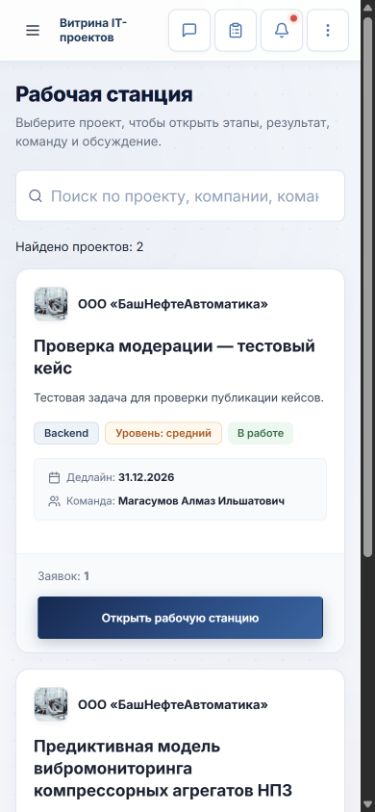
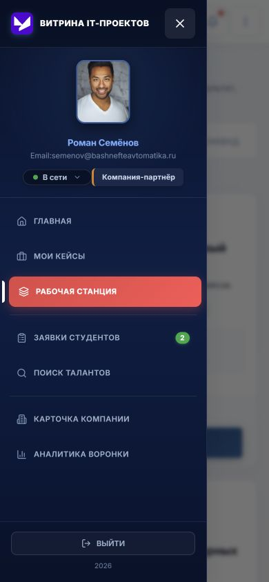

# Мобильная адаптация

Проверено в Chrome с изменением viewport, 25.10.2026. Размеры: 320×740, 390×844, 768×1024; контроль настольной версии 1440×900. Это проверка адаптивной раскладки, не тест на физических iOS/Android-устройствах.

## Реализовано

- Компактная верхняя панель, выдвижное меню с кнопкой закрытия, затемнением фона, блокировкой фоновой прокрутки и удержанием фокуса. Закрытие по Escape, нажатию на фон и переходу в раздел; восстановление фокуса после закрытия.
- Одноколоночные каталоги и подробные карточки, переносы названий и действий, адаптированный профиль без обрезания имени.
- Формы и модальные окна в одну колонку на небольших экранах; внутренний скролл формы и доступные кнопки внизу окна.
- Области нажатия основных кнопок от 44 px, поля ввода размером шрифта 16 px на мобильных экранах, поддержка уменьшенной анимации.
- Вкладки и широкие таблицы прокручиваются внутри собственных блоков. Горизонтальная прокрутка всей страницы для проверенных сценариев не требуется.

## Пройденные сценарии

| Область | Проверка |
| --- | --- |
| Студент | Главная, витрина, описание кейса, рабочая станция и этапы, студенческие проекты и подробная карточка, профиль и редактирование, форма публикации |
| Партнер | Главная, заявки кандидатов, рекомендации, профиль компании, аналитика, форма размещения кейса |
| Куратор | Очередь модерации кейсов, фильтры, карточки решений |
| Общие | Вход, регистрация, поиск, мобильное меню, закрытие Escape/переходом, восстановление прокрутки |
| Настольная версия | Боковое меню видно, сетка кейсов многоколоночная, переполнения страницы нет |

Дополнительно: сборка TypeScript/Vite, существующие автоматические тесты и `git diff --check`.

