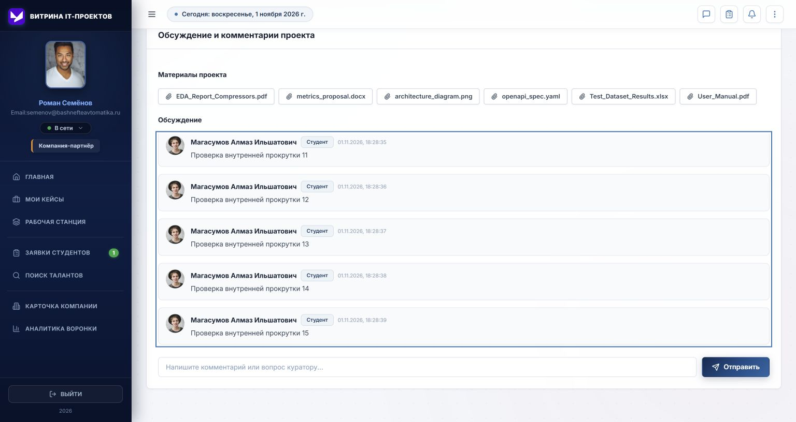

# Исправления по отчету тестирования спринта 2

Проверено 01.11.2026. Исходный отчет относится к `b09b7c5`; большая часть исправлений уже входит в `f623e56`. Ниже — сверка текущего фронтенда, а не повторный запуск исходных 62 e2e-тестов.

| № отчета | Исправление в текущем коде |
| --- | --- |
| 1 | Сохранение профиля обновляет `auth.currentUser`, `allUsers` и `studentsList`; собственный профиль берет актуального пользователя. |
| 2 | У ленты обсуждения ограничена высота, есть внутренний скролл. В этом проходе запрещено сжатие сообщений и добавлены фокус с клавиатуры, доступное название и удержание прокрутки внутри блока. |
| 3 | «Прикрепить материалы» открывает диалог с выбором файла или ссылки. Поля названия нет. |
| 4 | На вкладке результата нет блока скриншотов. |
| 5 | Участники команды ведут в профиль. В этом проходе добавлена ссылка и для индивидуального исполнителя при наличии его ID. |
| 6 | В оценке указаны проект, компания и команда либо индивидуальный исполнитель. |
| 7 | Интервью доступно только для активных заявок; для принятой заявки показан переход в рабочую станцию. |
| 8 | Сложность кейса: «Начальный», «Средний», «Высокий», без грейдов и курсов. |
| 9 | ID в сайдбаре компании скрыт. |
| 10 | Шапка сайдбара — «Витрина IT-проектов»; в футере только год. |
| 11 | Новостная лента и расписание удалены с главной. |
| 12 | Панель семестров удалена из витрины кейсов. |
| 13 | Плашки подписаны: «Уровень: …» и «Конфиденциальность (NDA)». |
| 14 | В отклике нет поля ссылки на портфолио. |
| 15 | Условия прав на результаты раскрываются через иконку информации. |
| 16 | В проектах студентов фильтр называется «Все направления разработки». |
| 17 | Удалены видимые пометки пунктов ТЗ и лишний брендинг, эмодзи табов заменены SVG-иконками. Технические комментарии исходников не являются текстом интерфейса. |

## Проверки этого прохода

- `npm --prefix frontend test`: 21/21, включая сохранение профиля, синхронизацию каталога студентов и запрет интервью после принятия.
- `npm --prefix frontend run build`: успешно; остаются предупреждения Sass об `@import` и Vite о размере основного чанка.
- Chrome, mock, отдельный origin `127.0.0.1:3002`: изменение «О себе» и стека сохранилось после перезагрузки; окно материалов содержит выбор «Файл / Ссылка»; окно оценки показывает NeuralKoders; ID компании отсутствует.
- В обсуждение отправлены 15 сообщений: всего 18, высота ленты 408 px, содержимого 1534 px. Высота страницы осталась 1225 px до и после отправки. Данные проверки находятся только в локальном mock-хранилище этого origin.

Исходные Playwright-тесты из ветки `feature/e2e-tests` в текущем checkout отсутствуют, команды `test:e2e` нет. Результаты Chromium/WebKit из исходного отчета не переобозначены как прошедшие. Полный межбраузерный прогон и интеграция с бэкендом здесь не выполнялись.

